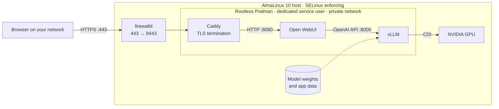

# Tänka sig! (Imagine That!)  

## Introduction

**Your own self-hosted, sovereign and hardened AI Box. Just like you would want it.**

Tänka sig (taenkasig) is a proof-of-concept for deploying a private, hardened AI platform in your own on-prem environment.
Assuming you have capable metal, this repo will spin up a fully functioning AI/LLM server that runs on AlmaLinux OS.

The repo consists of provisioning playbooks written with Ansible (YAML).

### What does it run on?

| Component      | Part                                                                                 |
|----------------|--------------------------------------------------------------------------------------|
| Case           | Zalman Z1 Iceberg White                                                              |
| Motherboard    | ASUS PRIME B550-PLUS                                                                 |
| Storage (OS)   | Kingston A400 SATA SSD (operating system and container images)                       |
| Storage (data) | Kingston NV3 2 TB M.2 NVMe SSD, PCIe Gen 4 (files are stored locally here)           |
| RAM            | 32 GB DDR4-3200 CL16: 2 × Kingston Fury Beast 16 GB kits (2 × 8 GB, KF432C16BBK2/16) |
| CPU            | AMD Ryzen 7 5700X                                                                    |
| CPU cooler     | MSI MAG CoreLiquid A13 240 Black                                                     |
| GPU            | Gigabyte GeForce RTX 5060 Ti WINDFORCE MAX OC 16 GB                                  |
| PSU            | Corsair RM750x, 750 W, ATX 3.1, 80 PLUS Gold                                         |

## Architecture & security

### Is it safe to use?
The project is still in early stages and it is **not ready for production**. Exercise caution and read the playbooks before you run them. Take extra care to look over your partition plans.  
**Don't run the playbooks on a host with important data.**  
This project aims to provide a simple way to deploy a **reasonably hardened and secure** AI/LLM Platform. Note that Cyber security is never "turnkey".  
The security and threat landscape of AI/LLMs - Not to mention *tech in general* - is **constantly changing**!  
You must assess your own risks and take reasonable precautions.  

Having said that:



- **One way in**
  - Caddy is the only container that publishes a port.
  - Traffic is TLS-encrypted from the browser to the host.
  - Open WebUI and vLLM are reachable only by container name, on a private Podman network.
  - Their ports are explicitly closed in firewalld.
- **No root containers**
  - All three services run rootless as Podman quadlets.
  - They run under a dedicated system user with no login shell and its own subordinate UID/GID range.
  - They start at boot as systemd units, without anyone logged in.
- **SELinux stays enforcing**
  - The container data directories are labeled `container_file_t`.
  - Only the four NVIDIA device nodes that vLLM needs are relabeled.
  - The GPU reaches the container through CDI and the `container_use_devices` boolean.
- **Ordered, health-gated startup**
  - vLLM only counts as started once its API answers a health check.
  - Open WebUI starts after vLLM, and Caddy after Open WebUI.
- **Verified on every run**
  - The playbook checks that Open WebUI reaches vLLM over the container network.
  - It also checks that Caddy serves Open WebUI over TLS.
- **Everything is configuration**
  - The model, engine flags, images and site name all live in vars files.
  - The default model is `mistralai/Ministral-3-8B-Instruct-2512` (Apache 2.0).

## Quick start

### PREREQUISITES

Some of these prerequisites are going to be automated in a future release. Anaconda install options along with capability of booting the platform from a USB stick are planned features. Customization of environment variables using a human-interactive script is also planned.

**Your AI Host**
- AlmaLinux 10 installed, with SELinux enforcing and firewalld running (both are the defaults).
- An NVIDIA GPU. The default model and settings are sized for 16 GB of VRAM.
- Storage for model weights and app data, already mounted. The playbook never partitions or mounts disks. Point `container_data` at it.
- Room under `/home` for container images. Rootless Podman keeps images in the service user's home directory, and the vLLM image alone is about 16 GB.
- An admin account that you can reach over SSH with a key and that has sudo rights.

**The control node** (the machine you run Ansible from)
- `ansible-core` and `git`.

**Network and DNS (out of scope for this repo, so set these up first)**
- **A fixed address for the host.** Use a static IP or a DHCP reservation.
- **A name that resolves to the host.** Users reach the stack by the name in `caddy_site_address`, so it must resolve to the host's IP for every client. Use an A record on your DNS server, or a hosts-file entry on each client.
- **Inbound 443 from your clients.** The playbook opens 443 and 8443 (TCP and UDP) in the host's firewall and forwards 443 to Caddy. If another firewall sits between your clients and the host, you must allow 443 there too.
- **Outbound HTTPS from the host.** The first run downloads packages from the AlmaLinux, EPEL and NVIDIA repositories, container images from `docker.io` and `ghcr.io`, and the model from `huggingface.co`.
- **A trusted network.** This stack is built for a private network and is not meant to be exposed to the internet.

### Steps

```bash
git clone https://github.com/machinemonarch/taenkasig.git
cd taenkasig
./setup.sh                                                      # Installs the required Ansible collections
cp inventory.yml.example inventory.yml                          # Your hosts
cp host_vars/vllm01.yml.example host_vars/vllm01.yml            # Per-host settings
cp group_vars/inference.yml.example group_vars/inference.yml    # Container and model settings
```

Edit the copies. Your real files are gitignored, so they never end up in a commit.

| File                         | What to set                                                                                                      |
|------------------------------|------------------------------------------------------------------------------------------------------------------|
| `inventory.yml`              | `ansible_host` (the host's IP) and `ansible_user` (your SSH admin account).                                      |
| `host_vars/vllm01.yml`       | `podman_user` (the service account the playbook creates), `podman_network` and `container_data` (your mounted storage). Rename the file if your host isn't called `vllm01` in the inventory. |
| `group_vars/inference.yml`   | `caddy_site_address` (the DNS name users will browse to). Change `vllm_model` and `vllm_engine_args` if you want a different model. |

Then run the playbook. Add `-K` if sudo asks for a password.

```bash
ansible-playbook -i inventory.yml site.yml
```

The first run takes a while. The host reboots once after the NVIDIA driver is installed, the images are large, and vLLM gets up to 15 minutes to download and load the model. The run is done when both checks in the final verify step pass. Then browse to `https://<caddy_site_address>`.

### After deploying

- **Create the admin account immediately**
  - The first account registered in Open WebUI becomes its administrator.
  - Register yours right after the first run, before anyone else can reach the page.
  - Later sign-ups have to be approved by an admin.
- **Expect a certificate warning at first**
  - Caddy issues the certificate from its own internal CA.
  - To get rid of the warning, import that CA's root certificate into your clients' trust stores.
  - On the host it is at `<container_data>/caddy/data/caddy/pki/authorities/local/root.crt`.

## Design Philosophy

### Was AI used to write this?
Claude AI is used in **manual mode** throughout this project and every single line of code has been carefully vetted and questioned by a **human** before being accepted.  
Every design choice and every function in this repo has a justification for existing. So, while I'm only human, I can guarantee that where there was doubt research followed.
## Status and planned features

This is a **proof of concept**. It has been developed and tested on my own server (the hardware mentioned above). It works end to end, but it has not yet been run against a range of hardware or clean installs.

Coming up:
- A bootstrap script allowing for human-interactive configuration of variables and SSH keys, eventually resulting in the:
  - Kickstart configs for the Anaconda installer, allowing unattended bare-metal install of AlmaLinux (USB image) that prepares the host for subsequent Ansible provisioning.
- Selectable hardening levels depending on industry compliance requirements.
  - Enforcement and auditable verification by OpenSCAP.
- Swappable certificates from your own CA or ACME, applied by a separate playbook, to replace Caddy's internal CA.
- Authenticated API access to vLLM through the reverse proxy.

## License

[MIT](LICENSE)
